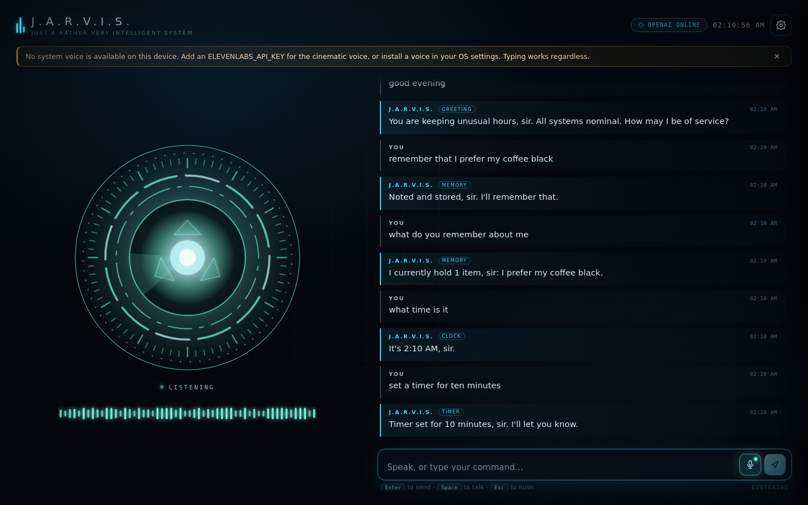
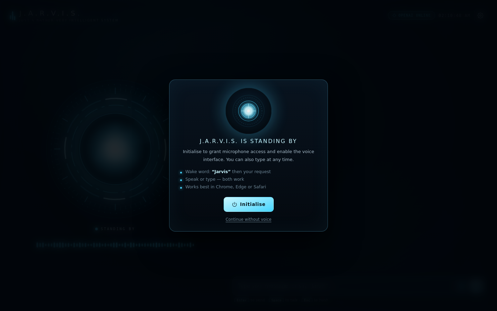
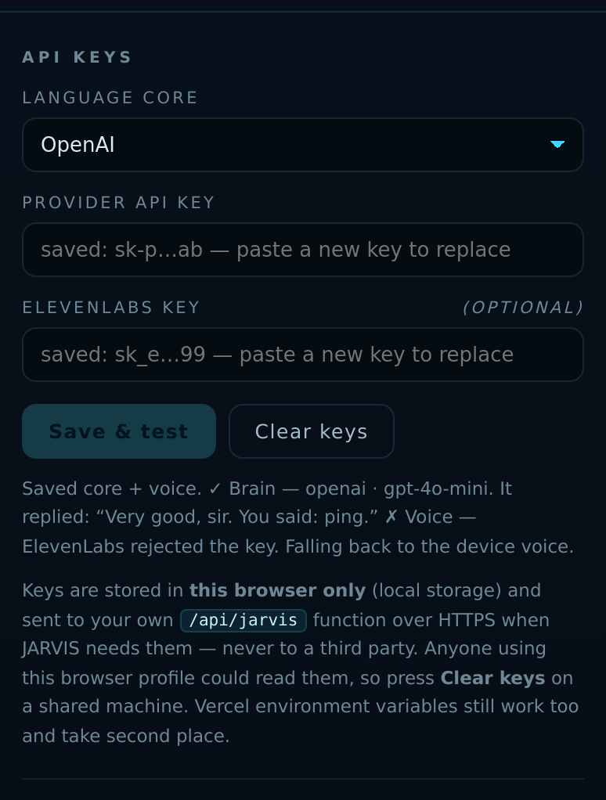
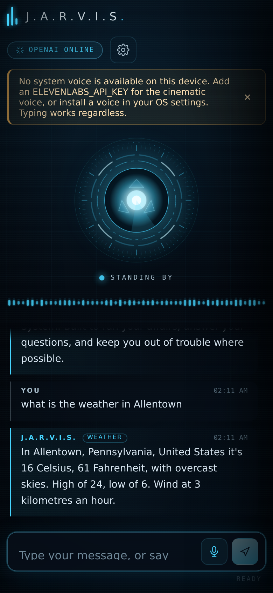

# J.A.R.V.I.S.

*Just A Rather Very Intelligent System* — a personal, voice-first assistant with an Iron Man HUD.
Say **“Jarvis”**, speak your mind, and he answers in a British butler's voice, calling you **sir**.
You can type to him just as easily.

Everything sits in one flat folder. **No framework, no build step, no npm install, no dependencies.**
Two plain files of JavaScript, one stylesheet, one HTML page, and one serverless function.



<details>
<summary>More screenshots</summary>

| | |
| --- | --- |
|  |  |



</details>

---

## Every file, and what it does

```
index.html            the page: HUD markup, settings panel, boot screen
styles.css            all the styling (the Iron Man look)
app.js                the application: wake word, voice, chat, memory, rendering
commands.mjs          instant local commands (time, weather, timers, maths, notes)
speech-utils.mjs      text-to-speech clean-up and British-male voice ranking
api/jarvis.js         the only server-side code: talks to the AI provider, hides your key
dev-server.js         optional: `node dev-server.js` to run the whole thing locally
tests.mjs             optional: `node tests.mjs` to run the unit tests
vercel.json           response headers (microphone permissions etc.)
icon.svg              app icon
manifest.webmanifest  makes it installable on a phone home screen
.env.example          every environment variable, all optional
.gitignore            keeps your keys out of the repo
screenshot-*.png      the images in this README
```

Nothing is generated and nothing is compiled — what you push is what runs.

> **Why is there one folder?** Vercel requires serverless functions to live in `api/`. That's the
> only reason `api/jarvis.js` isn't at the top level. Everything else is flat.

---

## Deploy to your own Vercel

**1. Push it**

```bash
git init
git add .
git commit -m "J.A.R.V.I.S."
git branch -M main
git remote add origin https://github.com/YOUR-USERNAME/jarvis.git
git push -u origin main
```

**2. Import it** — go to [vercel.com/new](https://vercel.com/new), pick the repo, press **Deploy**.
There is nothing to configure: Vercel serves the files as a static site and turns `api/jarvis.js`
into a serverless function automatically. (If it asks, the framework preset is **Other**.)

**3. Add one free key** — **Project → Settings → Environment Variables**:

```
GEMINI_API_KEY = <your key>
```

Free, no credit card, from <https://aistudio.google.com/apikey>. Then
**Deployments → ⋯ → Redeploy** so the new variable takes effect.

Open the deployment, press **Initialise**, allow the microphone, and say
*“Jarvis, what's the weather?”*

> With no key at all it still runs: local commands respond and conversation falls back to a small
> in-character offline brain. The header will read `offline core` until you add one.

---

## Picking a brain (every free option)

Set **one**. The app auto-detects whichever is present:

| Variable | Provider | Free tier | Notes |
| --- | --- | --- | --- |
| `GEMINI_API_KEY` | Google Gemini | ✅ generous, no card | **Recommended.** |
| `GROQ_API_KEY` | Groq | ✅ generous, no card | Fastest replies; Llama 3.3 70B. |
| `OPENROUTER_API_KEY` | OpenRouter | ✅ `:free` models | Many models, one key. |
| `OPENAI_API_KEY` | OpenAI | ❌ paid | Supported if you have one. |
| `ANTHROPIC_API_KEY` | Anthropic | ❌ paid | Supported if you have one. |
| `OPENAI_API_KEY` + `OPENAI_BASE_URL` | any OpenAI-compatible server | ✅ if local | Ollama, LM Studio, LiteLLM. e.g. `http://localhost:11434/v1` |

Priority is Gemini → Groq → OpenRouter → OpenAI → Anthropic. Override with
`JARVIS_PROVIDER=groq`. Model names can be overridden per provider
(`GEMINI_MODEL`, `GROQ_MODEL`, `OPENROUTER_MODEL`, `OPENAI_MODEL`, `ANTHROPIC_MODEL`), and a
retired Gemini model name self-heals by trying the next one.

Your key is read **only** inside `api/jarvis.js`, on the server. It is never sent to the browser.


---

## Two ways to add your key

### Option A — in the app (no Vercel setup at all)

Open JARVIS → **Systems → API keys**, choose your provider, paste the key, press **Save & test**.
That's it — no redeploy, no environment variables. It reports `✓ Brain — gemini · gemini-2.5-flash`
or the exact rejection reason, and once a test (or any real reply) succeeds the header pill switches
to `gemini online`. Until the key has been proven with a request it reads `gemini key set` in amber —
saved and loaded, but not yet confirmed — so the header never claims a connection it hasn't made.

Keys entered here are stored in **this browser only** (`localStorage`) and sent to your own
`/api/jarvis` function over HTTPS on each request, where they're used and never stored or logged.

> **The trade-off, plainly:** anyone using this browser profile can read the key (open DevTools →
> Application → Local Storage). On a shared machine press **Clear keys**. The upside: a key in the
> browser is invisible to anyone who merely visits your deployment URL, and there's nothing to
> misconfigure on Vercel — which is why it's the most reliable option.
>
> Keys in the app take precedence; environment variables are the fallback. Both work together.

### Option B — on the server (Vercel environment variables)

**1. Get the key** — <https://aistudio.google.com/apikey> → sign in with any Google account →
**Create API key** → *Create API key in new project* → copy the string. No credit card, no billing.
Some keys start with `AIza`, newer ones don't — don't judge a key by its prefix.

**2. Put it in Vercel** — your project → **Settings → Environment Variables**:

| Field | Value |
| --- | --- |
| Key | `GEMINI_API_KEY` |
| Value | the key on its own — **no quotes, no `GEMINI_API_KEY=` in front** |
| Environments | tick **Production**, **Preview** *and* **Development** |

Press **Save**.

**3. Redeploy** — **Deployments → ⋯ (on the newest one) → Redeploy**. Environment variables are
only read at deploy time; adding one does **not** change a deployment that already exists.

**4. Check it** — open these two URLs on your deployment:

```
https://YOUR-APP.vercel.app/api/jarvis?action=health
https://YOUR-APP.vercel.app/api/jarvis?action=ping
```

| You see | It means |
| --- | --- |
| `"provider":"gemini","llm":true` | ✅ the function can see your key |
| `"llm":false` | ❌ key not visible — wrong name, wrong environment, or no redeploy after adding |
| `404 Not Found` | ❌ `api/jarvis.js` isn't deployed — wrong repo pushed, or framework preset stuck on Next.js (Settings → Build & Development Settings → Framework Preset = **Other**) |
| ping → `{"ok":true,…}` | ✅ the key actually authenticates |
| ping → `API key not valid` | ❌ the key is wrong, revoked, or has a stray character |

The **Test connection** button in **Systems → Status** runs that same ping for you, in the app.

**If both keys seem to be ignored**, open:

```
https://YOUR-APP.vercel.app/api/jarvis?action=diagnose
```

It lists every variable JARVIS looks for with `present: true/false`, the length and a masked prefix
(never the secret), plus any **near-miss names** — so a variable called `ELEVENLABS_KEY` or
`GEMINI_API` shows up immediately as a typo. It also tells you which commit and environment you're
actually hitting, which settles "did my redeploy take?".

`"tts":"elevenlabs"` in the health output means your ElevenLabs key was seen; `"browser"` means it
wasn't (the app still speaks, using the device voice — so a bad ElevenLabs key is never fatal).

---

## The voice

Two engines, in order of preference:

1. **ElevenLabs** — the cinematic, film-accurate voice. Add:
   ```
   ELEVENLABS_API_KEY = <your key>
   ELEVENLABS_VOICE_ID = onwK4e9ZLuTAKqWW03F9   # "Daniel", British male
   ```
   Free tier exists but is limited. If it's missing, rate-limited or rejected, the app quietly
   falls back to the browser voice.

2. **Browser speech synthesis** — free, zero setup. JARVIS auto-selects the best British male voice
   on your device (*Daniel* / *Arthur* / *Oliver* on Apple, *Ryan* / *George* on Windows,
   *Google UK English Male* on Chrome). Choose a specific one in **Systems → Voice**, with rate,
   pitch, volume and a **Test voice** button.

> Voice availability is a property of your device, not of this code. On iOS,
> **Settings → Accessibility → Spoken Content → Voices → Daniel (Enhanced)** makes an audible
> difference.

---

## Using it

**Voice** — press **Initialise**, allow the mic, then:

- *“Jarvis.”* → he replies “Listening, sir…” and waits for your request.
- *“Jarvis, what's the weather in London?”* → one breath, immediate answer.
- *“Jarvis, set a timer for ten minutes.”* → he announces it when it elapses.

**Listening modes** (Systems → Listening):

- **Wake word** — always listening, responds only to “Jarvis”. Best default.
- **Always on** — responds to everything it hears. Use headphones.
- **Push to talk** — mic open only while you press the mic button or **Space**.

**Shortcuts** — `Space` talk · `Enter` send · `Esc` hush / close panel.

**Instant commands** (no API call, no network except weather):

```
what time is it · what's the date
weather · weather in Tokyo · is it raining
set a timer for ten minutes · timer for 90 seconds · remind me in half an hour
what is 12 * 7 · sqrt(144) · 15% of 80 · 2^10
flip a coin · roll a d20 · random number between 1 and 100
remember that I take my coffee black
what do you remember · forget everything
take a note buy arc reactor parts · read my notes · clear my notes
open youtube · what can you do · go to sleep / wake up
stop · clear the conversation
```

Timers accept spoken numbers — “ten minutes”, “twenty five minutes”, “half an hour”.

Everything else goes to the language model, with your remembered facts and the current time
injected into the system prompt so he never guesses what time it is.

---

## Running it locally

No install step, no dependencies:

```bash
node dev-server.js        # → http://localhost:3000
```

`dev-server.js` serves the files and mounts `api/jarvis.js` on `/api/jarvis`, exactly like Vercel
does. It also reads `.env.local` if present, so your keys work locally:

```bash
cp .env.example .env.local
# then paste your GEMINI_API_KEY into it
```

Tests:

```bash
node tests.mjs            # 46 checks: maths parser, commands, speech helpers
```

Speech recognition needs `localhost` or HTTPS — both qualify.

---

## How it works

- **Wake word** — continuous Web Speech recognition; everything is ignored until the transcript
  contains “Jarvis”, which then opens a 12-second window for your request. Push-to-talk bypasses
  the gate entirely.
- **Mic ducking** — recognition is aborted the moment JARVIS starts talking and resumed 250 ms
  after he stops, so he never transcribes himself.
- **Streaming** — the function streams newline-delimited JSON; `app.js` appends each chunk, so
  replies appear word by word and speech starts as soon as a sentence is complete.
- **No `eval`** — arithmetic goes through a hand-written recursive-descent parser.
- **No injection** — every message is rendered with `textContent`, never `innerHTML`.
- **Memory is local** — conversation and facts live in `localStorage` on your device. Nothing is
  stored on the server; *Reset everything* in Systems wipes it.

---

## Troubleshooting

**“Microphone access is blocked”** — padlock in the address bar → Site settings → Microphone →
Allow, then reload. Mic only works on HTTPS or localhost.

**Nothing happens when I say “Jarvis”** — Chrome, Edge or Safari only; Firefox has no speech
recognition. Check the footer state reads `ready` or `listening`.

**He answers his own voice** — use **Wake word** or **Push to talk** instead of **Always on**.

**No British voice** — install one at OS level, or add an ElevenLabs key.

**Keys set in Vercel but JARVIS still says offline?** Skip Vercel entirely: **Systems → API keys**
→ paste the key → **Save & test**. It bypasses every deployment-configuration problem (wrong
project, wrong scope, missed redeploy) because the key travels with each request from your browser.

**“offline core” in the header after adding a key** — in order of likelihood:
1. You didn't redeploy *after* adding it (env vars are read at deploy time, not live).
2. The variable is scoped to only Preview/Development but you're on Production.
3. The name is misspelled (`GEMINI_API_KEY`, exactly). Quoted values and pasted `NAME=value`
   pairs are tolerated by the code now, but the name must be right.
4. You're viewing a deployment from before the variable existed — open Deployments and redeploy
   the newest one.

**“I'm having difficulty reaching my language core… (API key not valid)”** — the key reached the
function but Google rejected it. The key was copied incompletely, was revoked (Google auto-revokes
keys it finds in public repos), or belongs to a project with the Gemini API disabled. Make a fresh
key in AI Studio and replace the variable, then redeploy.

**`/api/jarvis` returns 404** — the function isn't deployed. Usually the Vercel project still has
the framework preset from an earlier Next.js deploy: **Settings → Build & Development Settings →
Framework Preset = Other**, then redeploy. Or the pushed repo doesn't contain `api/jarvis.js`.

**Works locally but not on Vercel** — make sure `api/jarvis.js` was committed (it's the only file
in a folder) and that the project runs Node 18+.

**He speaks in the device voice instead of the cinematic one** — that's the ElevenLabs fallback:
the key wasn't seen, was rejected, or the free-tier credits are spent. Check
`?action=health` for `"tts":"elevenlabs"`.

---

*At your service, sir.*
